Enlace del video: https://youtu.be/HAvaNGoS0uQ

El objetivo de esta práctica es configurar una red con un router y un switch Cisco, un servidor Windows Server (Active Directory y NPS) y un servidor Zabbix. Se aplica hardening al switch con un script propio, se implementa AAA con RADIUS solo en consola y auxiliar, DHCP, port-security, SNMP de solo lectura y acceso administrativo por SSH.

---

## Topología

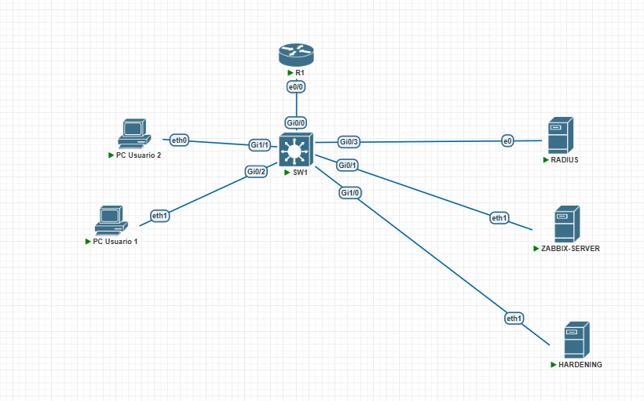

| Dispositivo | Rol |
|-------------|-----|
| R1 (Cisco) | Router. Servidor DHCP y cliente RADIUS |
| SW1 (Cisco IOSvL2) | Switch. Equipo al que se aplica el hardening |
| Servidor Windows (SRV-AAA) | Active Directory y NPS (RADIUS) |
| Servidor Zabbix (Linux) | Monitoreo SNMP |
| Máquina de hardening (Linux) | Ejecuta el script |
| PC de usuario (VPC) | Cliente DHCP |
| PC de usuarios (ubuntu para monitorear Zabbix) | Cliente DHCP |

---

## Direccionamiento

Matrícula: 2025-1410

| Dispositivo | IP |
|-------------|----|
| R1 | e0/0 | 14.10.10.1/28 |
| SW1 | Vlan1 | 14.10.10.2/28 |
| Servidor NPS | 14.10.10.5 | 
| Máquina de hardening | eth1 | 
| Servidor Zabbix | 14.10.10.3 |
| PC de usuarios | DHCP |

---

## Recomendaciones aplicadas por hardening

### Switch (SW1)

| CIS | Recomendación | Por qué se aplicó |
|-----|---------------|-------------------|
| 1.4.1 | `enable secret` | Protege el modo privilegiado con un hash en vez de una contraseña reversible |
| 1.4.2 | `service password-encryption` | Evita que las contraseñas se lean en claro en la configuración |
| 1.4.3 | Usuarios locales con `secret` | Impide contraseñas de usuario almacenadas sin protección |
| 1.2.2 | `transport input ssh` en `line vty` | Solo se permite administración remota cifrada |
| 1.2.7 | `exec-timeout` en `line console 0` | Cierra sesiones de consola abandonadas |
| 1.2.8 | `exec-timeout` en `line vty` | Cierra sesiones remotas abandonadas |
| 1.2.11 | `login block-for 900 attempts 3 within 120` | Frena ataques de fuerza bruta sobre el inicio de sesión |
| 1.3.2 | Banner de login | Avisa de que el acceso es restringido y se registra |
| 2.1.1.1.4 | `ip ssh time-out` de 60 s o menos | Limita el tiempo de un inicio de sesión SSH sin completar |
| 2.1.1.1.5 | `ip ssh authentication-retries` de 3 o menos | Limita los intentos de contraseña por conexión |
| 2.1.1.2 | SSH versión 2 | La versión 1 tiene vulnerabilidades conocidas |
| 2.1.2 | `no cdp run` | CDP revela información del equipo a quien lo escuche |
| 2.1.3 | `no ip bootp server` | Servicio innecesario |
| 2.1.4 | `service tcp-keepalives-in` | Descarta sesiones entrantes que quedaron colgadas |
| 2.1.5 | `service tcp-keepalives-out` | Descarta sesiones salientes que quedaron colgadas |
| 2.1.6 | `no service pad` | Servicio heredado innecesario |
| 2.2.2 | `logging buffered` | Conserva un registro local de eventos |
| 2.2.3 | `logging console critical` | Limita lo que se envía a la consola |
| 2.2.6 | `service timestamps debug datetime` | Permite correlacionar eventos en el tiempo |
| 2.2.8 | `login on-failure log` y `login on-success log` | Registra los inicios de sesión correctos y fallidos |
| 3.1.1 | `no ip source-route` | El enrutamiento de origen se usa en varios ataques |

## 1. Script de hardening

El script `auditor.py` usa Python, Netmiko y PyYAML. Aplica al switch las reglas CIS elegidas y genera un informe posterior.

```bash
# Solo informe. No cambia nada en el equipo.
python3 auditor.py --modo audit --salida salida_antes

# Aplica las reglas que fallan y genera el informe posterior.
python3 auditor.py --modo apply --salida salida_despues
```

### Evidencia

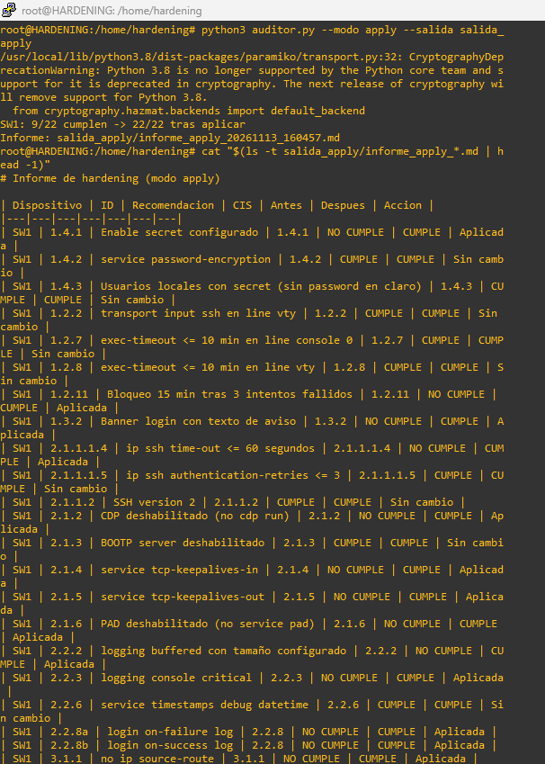

---

## 2. Direccionamiento y conectividad

Direccionamiento según la matrícula y hostname en todos los equipos.

[COMPLETAR: agregar capturas de los pings entre equipos y de `show ip interface brief`]

---

## 3. Port-security

Se configuró port-security en los puertos de acceso del switch con un máximo de 2 MAC por puerto y acción de violación `shutdown`. Se demuestra una violación al conectar una tercera MAC.


---

## 4. AAA solo en consola y auxiliar

AAA con RADIUS (NPS) se aplica únicamente a `line con 0` y `line aux 0` de R1. Las líneas VTY quedan con autenticación local.

### Servidor NPS

Grupos y usuarios en Active Directory:

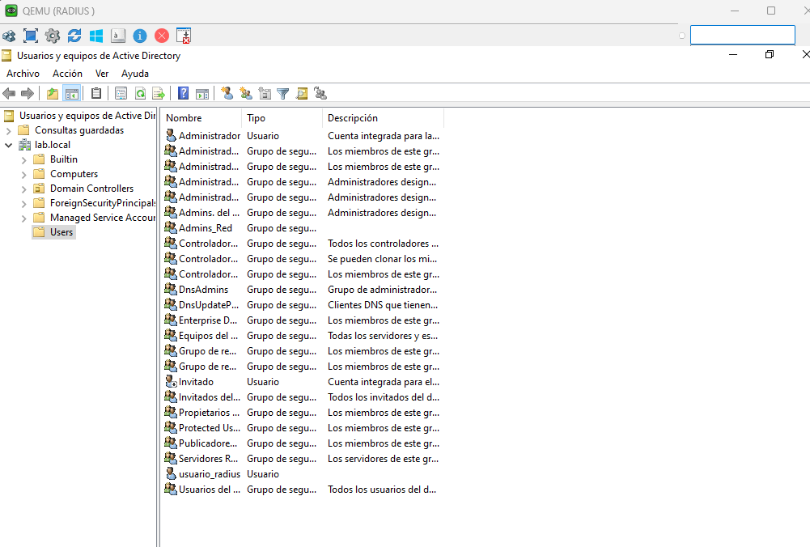

Cliente RADIUS (R1) en NPS:

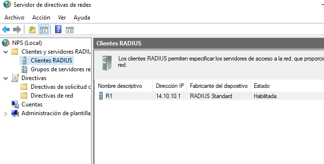

Directiva de red:

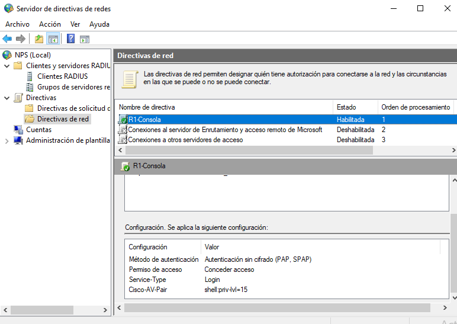

### Pruebas

Acceso a R1 con el usuario del dominio:

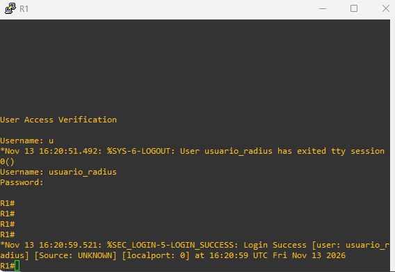

Evento en el servidor NPS que confirma la autenticación:

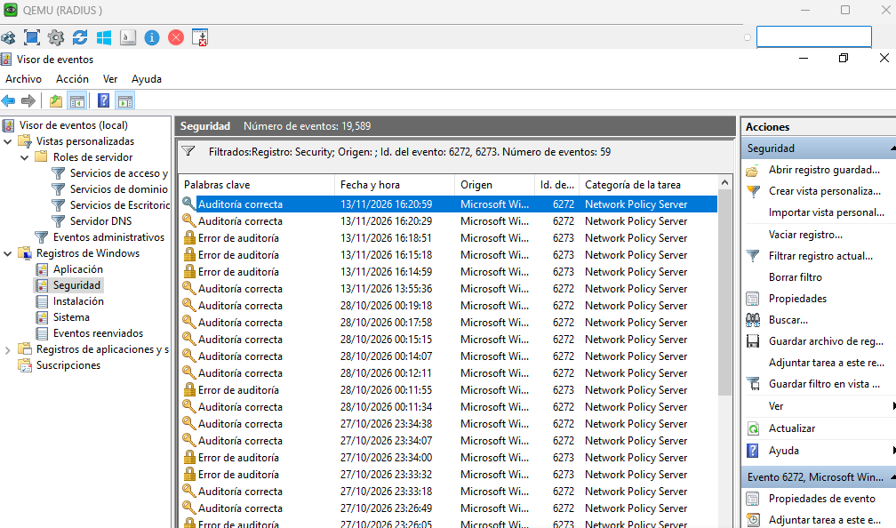

---

## 5. DHCP

R1 funciona como servidor DHCP para la red LAN. Los equipos de la LAN reciben su dirección por DHCP.

PC de usuarios:

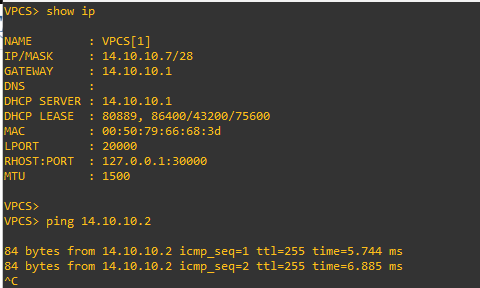

Máquina Zabbix (interfaz web):


---

## 6. SNMP en el switch

Hosts en Zabbix:

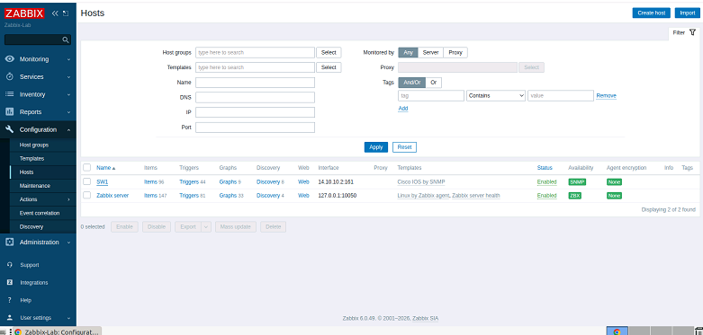

Host SW1 con la interfaz SNMP:

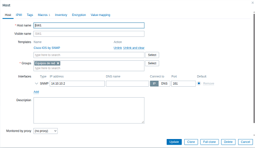

Datos recibidos del switch:

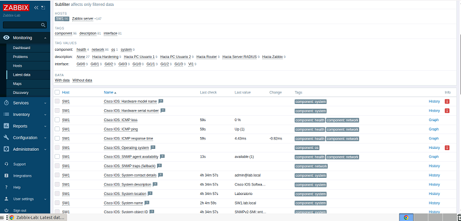

---

## 7. Acceso administrativo por SSH

Usuario local con contraseña cifrada y acceso remoto por SSH, sin Telnet, en R1 y SW1.

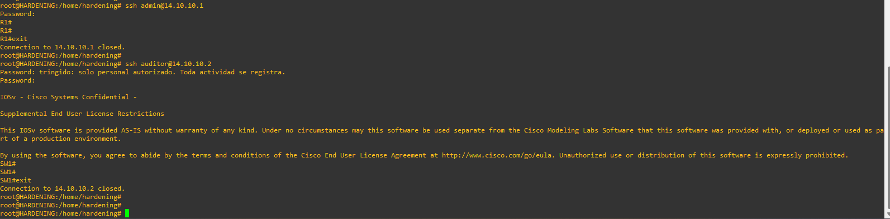

